# ⚡ Awesome Edge &amp; Small Language Models (SLMs) 🧠

  

  
  
  
  
  
  

---

## 🌟 Introduction &amp; Ecosystem Scope

A curated directory and engineering landscape of **Edge Artificial Intelligence (Edge AI)**, **On-Device Small Language Models (SLMs)**, **Mobile Inference Engines**, and **TinyML Runtimes**.

This repository tracks production-grade platforms, frameworks, quantized model weights, and developer toolchains designed to run high-capability language models—typically under **4 Billion parameters** (sub-4B)—directly on smartphones, PCs, microcontrollers, NPUs, and embedded edge silicon without cloud dependency.

### 🎯 Why Small Language Models at the Edge?
- 🔒 **100% Data Privacy &amp; Zero Egress**: User prompts and biometric context never leave the local silicon.
- ⚡ **Sub-Millisecond Latency**: Eliminates round-trip API network overheads for interactive UX.
- 🔋 **Zero Cloud Compute OpEx**: Slash monthly recurring token inference bills by shifting compute to client hardware.
- 📶 **Deterministic Offline Operation**: Functions reliably in air-gapped environments, remote fields, aircraft, and smart IoT nodes.

---

## 📑 Table of Contents

- [📊 Sector Overview &amp; Market Dynamics](#-sector-overview--market-dynamics)
- [☁️ SaaS &amp; Hosted Edge AI Platforms](#️-saas--hosted-edge-ai-platforms)
- [🛠️ Open-Source GitHub Projects](#️-open-source-github-projects)
- [🧩 Notable Edge-Optimized Model Families](#-notable-edge-optimized-model-families)
- [💡 Architectural Best Practices](#-architectural-best-practices)
- [🤝 How to Contribute](#-how-to-contribute)
- [💖 Support](#-support)
- [⭐ Star History](#-star-history)
- [📜 Disclaimer](#-disclaimer)

---

## 📊 Sector Overview &amp; Market Dynamics

The global **Edge AI and On-Device Small Language Models (SLMs)** market is valued at approximately **$20.4 Billion in 2024–2025** and is projected to expand aggressively past **$65+ Billion by 2030** (advancing at a compound annual growth rate of over **28%**), propelled by skyrocketing demand for low-latency client-side agentic workflows, on-device data sovereignty, and energy-efficient neural processing units (NPUs).

The sector exhibits **moderate fragmentation across hardware runtimes and embedded platforms** (spurred by competing silicon instruction sets from Qualcomm Snapdragon, Apple Neural Engine, MediaTek APU, Intel NPU, AMD Ryzen AI, and Arm Cortex-M/Ethos), paired with **high platform concentration at the flagship consumer OS layer** (dominated by Apple Intelligence, Google Android AICore, and Microsoft Windows Copilot+), making developer-facing cross-platform orchestration engines (such as llama.cpp, LiteRT, and ONNX Runtime) the foundational connective layer of the ecosystem.

---

## ☁️ SaaS &amp; Hosted Edge AI Platforms

The table below catalogs leading commercial and hosted SaaS platforms facilitating edge model compilation, cloud-to-edge deployment pipelines, and remote hardware benchmarking. Entries are **sorted descending by company scale (market capitalization / valuation)**:

| 🏢 Platform / Product | 📈 Company &amp; Scale (Valuation / Revenue) | 🎯 Core Edge / SLM Offering | 💳 Pricing (Specific Starting Tier) | 🎁 Free Tier Limits &amp; Trial Scope |
| :--- | :--- | :--- | :--- | :--- |
| **[Apple Intelligence](https://developer.apple.com/apple-intelligence/)** | **Apple Inc.** • Market Cap: **~$3.45 Trillion** • Revenue: ~$391.0B/year | On-device foundation models (3B SLM on Apple Neural Engine), Core ML 8 runtime, and Foundation Models APIs | **$99.00 / year** (Apple Developer Program fee required for distribution, enterprise provisioning, and production CloudKit) | **Free forever Apple ID Account**: Deploy and test on up to 3 personal registered devices with 7-day provisioning renewal; full local Xcode debugging access |
| **[Microsoft Azure AI Foundry](https://azure.microsoft.com/en-us/solutions/ai/)** | **Microsoft Corp.** • Market Cap: **~$3.15 Trillion** • Revenue: ~$245.1B/year | ONNX Runtime Mobile INT4/INT8 quantization, DirectML NPU execution, and Phi-3.5/Phi-4-mini serverless-to-edge bridge | **$0.150 per 1M input tokens** **$0.600 per 1M output tokens** (Azure AI Foundry Phi-3.5-mini Serverless Pay-As-You-Go starting tier) | **30-Day Free Trial with $200.00 credits** via Azure Free Account, plus 12 months access to 55+ services; ONNX Runtime open engine is 100% free |
| **[Google AI Studio / LiteRT](https://deepmind.google/models/gemini/nano/)** | **Alphabet Inc. (Google)** • Market Cap: **~$2.15 Trillion** • Revenue: ~$350.0B/year | Gemini Nano on-device multimodal runtime (Android AICore &amp; Chrome), LiteRT-LM mobile tooling, and Gemma edge checkpoints | **$0.075 per 1M input tokens** **$0.300 per 1M output tokens** (Google AI Studio Pay-As-You-Go starting tier; Android AICore system runtime is $0 royalty for certified device apps) | **Free forever Developer Tier**: 15 Requests Per Minute (RPM), 1,000,000 Tokens Per Minute (TPM), and 1,500 Requests Per Day (RPD) on Gemini Flash via AI Studio |
| **[Qualcomm AI Hub](https://www.qualcomm.com/developer/software/qualcomm-ai-stack)** | **Qualcomm Inc.** • Market Cap: **~$195.0 Billion** • Revenue: ~$38.8B/year | Qualcomm AI Hub Workbench, remote device profiling on real physical Snapdragon 8 Gen 3/Elite NPUs, pre-quantized SLMs | **$0.00 / month ($0 royalty)** for developer platform access and Qualcomm Neural Processing SDK; Snapdragon hardware silicon priced per unit | **Free forever with Qualcomm ID**: Unlimited cloud model quantization and compilation, plus up to 20 remote physical hardware benchmark runs per day on hosted cloud testbed |
| **[MediaTek NeuroPilot](https://www.mediatek.com/technology/neuropilot)** | **MediaTek Inc.** • Market Cap: **~$68.0 Billion** • Revenue: ~$16.4B/year | NeuroPilot SDK and APU toolchain optimizing edge LLMs/SLMs for Dimensity mobile chipsets and Genio smart IoT platforms | **$0.00 / developer license** for NeuroPilot Core SDK and APU compiler; commercial runtime licensing bundled with silicon procurement | **Free forever portal account**: Unrestricted access to NeuroPilot SDK releases, APU compiler binaries, documentation, and reference INT4/INT8 quantization scripts |
| **[Hugging Face Hub](https://huggingface.co/)** | **Hugging Face Inc.** • Valuation: **~$4.5 Billion** • Revenue: ~$130M+ run-rate | Model registry for SmolLM2/3, Transformers.js in-browser execution, GGUF repository artifacts, and Serverless Edge APIs | **$9.00 / month** (Hugging Face PRO tier with priority compute and 5x serverless rate limits; Team tier starts at $20/seat/month) | **Free forever Community Account**: 300 requests/hour on Serverless Inference API, unlimited public SLM model hosting, and up to 10 GB storage per repo |
| **[Edge Impulse Platform](https://www.edgeimpulse.com/)** | **Edge Impulse Inc.** • Valuation: **~$200.0 Million** • Total Funding: $30.0M (Series B) | TinyML &amp; SLM deployment studio for microcontrollers, DSPs, NPUs, and embedded Linux boards (ESP32, Cortex-M, Raspberry Pi) | **$39.00 / month per seat** (Starter/Team plan billed annually for expanded pipeline compute credits; custom Enterprise tier for fleet management) | **Free forever Developer Plan**: 3 private projects, up to 10 experiments per project, 3 collaborators, and up to 60 minutes of GPU training compute per month |

---

## 🛠️ Open-Source GitHub Projects

The following curated open-source projects comprise the backbone of edge inference engines, model conversion frameworks, on-device runtimes, and local model families. Entries are **sorted descending by GitHub star count**:

1. **[ollama/ollama](https://github.com/ollama/ollama)**   
   🚀 The leading developer framework and local server to get up and running with LLaMA, Phi, Gemma, and Mistral SLMs locally on macOS, Linux, and Windows with a seamless CLI and OpenAI-compatible REST API.

2. **[ggml-org/llama.cpp](https://github.com/ggml-org/llama.cpp)**   
   ⚡ The foundational C/C++ LLM/SLM inference engine powering the local AI revolution. Enables plain C/C++ execution without dependencies, state-of-the-art GGUF 2-bit to 8-bit quantization, and blazing-fast acceleration across Apple Metal, CUDA, Vulkan, and ARM NEON.

3. **[nomic-ai/gpt4all](https://github.com/nomic-ai/gpt4all)**   
   🖥️ Privacy-first, open-source desktop ecosystem and client allowing consumer laptops and edge PCs to run quantized SLMs locally without an internet connection or telemetry.

4. **[ggml-org/whisper.cpp](https://github.com/ggml-org/whisper.cpp)**   
   🎙️ High-performance C/C++ implementation of OpenAI's Whisper speech recognition model. Designed for edge audio transcription on Raspberry Pi, mobile devices, and microprocessors with zero memory allocations.

5. **[mudler/LocalAI](https://github.com/mudler/LocalAI)**   
   🔌 Free, open-source OpenAI drop-in replacement REST API for local CPU/GPU and edge appliances, supporting SLM text generation, audio transcription, and image synthesis without cloud vendor lock-in.

6. **[ml-explore/mlx](https://github.com/ml-explore/mlx)**   
   🍏 Apple Silicon machine learning framework developed by Apple Machine Learning Research, featuring unified memory multi-device arrays and native on-device SLM fine-tuning and inference.

7. **[QwenLM/Qwen2.5](https://github.com/QwenLM/Qwen2.5)**   
   🌏 Alibaba's powerhouse open-weights language model family featuring ultra-capable 0.5B, 1.5B, and 3B parameter variants with 128K context length, coding competence, and rich multilingual support.

8. **[Mozilla-Ocho/llamafile](https://github.com/Mozilla-Ocho/llamafile)**   
   📦 Mozilla's project that turns open SLMs into single-file multi-platform executables using Cosmopolitan Libc, allowing AI models to run on six operating systems across AMD64 and ARM64 without installation.

9. **[Tencent/ncnn](https://github.com/Tencent/ncnn)**   
   📱 Tencent's battle-tested neural network computing framework deeply optimized for mobile phone SoCs, ARM NEON assembly, and edge embedded devices with no third-party runtime dependencies.

10. **[mlc-ai/mlc-llm](https://github.com/mlc-ai/mlc-llm)**   
    🌐 Universal machine learning compiler-driven deployment engine. Compiles SLMs directly into native binaries running on iOS, Android, WebGPU (browsers), Windows, and Linux across heterogeneous GPUs.

11. **[microsoft/onnxruntime](https://github.com/microsoft/onnxruntime)**   
    ⚙️ Microsoft's high-performance cross-platform scoring engine. Features ONNX Runtime Mobile with INT4/INT8 quantization tailored for embedded Linux, Android, iOS, and DirectML hardware acceleration.

12. **[alibaba/MNN](https://github.com/alibaba/MNN)**   
    🏮 Alibaba's lightweight deep learning inference engine engineered for mobile and embedded devices, delivering state-of-the-art quantized SLM inference across smartphones, tablets, and IoT chips.

13. **[OpenBMB/MiniCPM](https://github.com/OpenBMB/MiniCPM)**   
    🦾 Ultra-dense 2B SLM and vision-language model family built specifically to match and surpass the capabilities of 7B-13B models on mobile edge chipsets while maintaining low power consumption.

14. **[jzhang38/TinyLlama](https://github.com/jzhang38/TinyLlama)**   
    🦙 Compact 1.1B parameter open-source Llama model trained on 3 Trillion tokens, serving as an ideal foundational model for embedded microcomputers, wearable tech, and edge IoT devices.

15. **[google-deepmind/gemma](https://github.com/google-deepmind/gemma)**   
    💎 Google DeepMind's official open weights and implementation of the Gemma model family, offering lightweight 2B parameter architectures engineered for seamless integration with LiteRT and mobile GPUs.

16. **[apple/coremltools](https://github.com/apple/coremltools)**   
    🍏 Apple's Python package for converting PyTorch, TensorFlow, and ONNX neural network models into Core ML format, featuring advanced palletization and weight compression for Apple Neural Engine (ANE).

17. **[pytorch/executorch](https://github.com/pytorch/executorch)**   
    🔥 Meta PyTorch's official end-to-end framework for deploying PyTorch-trained neural networks and SLMs to mobile devices, wearables, microcontrollers, and edge silicon with modular backends.

18. **[huggingface/smollm](https://github.com/huggingface/smollm)**   
    🤗 Hugging Face's fully open-source SLM family (135M, 360M, and 1.7B params) complete with training recipes, tokenizers, datasets, and benchmark suites optimized for on-device and browser agents.

19. **[microsoft/Phi-3CookBook](https://github.com/microsoft/Phi-3CookBook)**   
    📖 Microsoft's exhaustive cookbook and practical developer guides for fine-tuning, quantizing, and deploying Phi-3, Phi-3.5, and Phi-4 mini SLMs across mobile devices, IoT, and Windows Copilot+ NPUs.

20. **[mit-han-lab/llm-awq](https://github.com/mit-han-lab/llm-awq)**   
    💡 Activation-aware Weight Quantization (AWQ) for LLMs/SLMs from MIT HAN Lab. Protects salient weights to achieve true 4-bit edge inference with negligible perplexity degradation.

21. **[google-ai-edge/LiteRT](https://github.com/google-ai-edge/LiteRT)**   
    ⚡ Google's evolution of TensorFlow Lite for on-device generative AI and SLM inference, clocking over 50+ tokens/sec on mobile GPUs and supporting hardware NPU delegates across Android and iOS.

22. **[TilelliLab/atome-lm](https://github.com/TilelliLab/atome-lm)**   
    🔬 Ultra-compact ternary, zero-heap tiny language model engineered to run inside a $2 microcontroller (under 100 KB memory footprint) with bit-exact Python ↔ C99 ↔ ARM Cortex-M3 parity.

---

## 🧩 Notable Edge-Optimized Model Families

| 🧠 Model Family | 📏 Parameter Tiers | 📜 License | 💡 Edge Suitability &amp; Highlight |
| :--- | :--- | :--- | :--- |
| **Google Gemma 4 (E2B / E4B)** | 2B, 4B effective | Open Weights | Multimodal (text, vision, audio), 128K context, native tool calling; runs under 1.2 GB RAM via LiteRT-LM. |
| **Microsoft Phi-3.5 / Phi-4-mini** | 3.8B | MIT | Outperforms many 7B–14B models on STEM &amp; math; achieves 650 tokens/sec at 1.5W on Copilot+ PC NPUs. |
| **Qwen 2.5 (0.5B – 3B)** | 0.5B, 1.5B, 3B | Apache-2.0 | Best-in-class multi-lingual capability, coding, and structured JSON generation in sub-3B class. |
| **Hugging Face SmolLM2 / SmolLM3** | 135M, 360M, 1.7B | Apache-2.0 | 100% transparent dataset pipeline; 135M runs in bare-metal browsers via WebGPU or low-power embedded CPUs. |
| **OpenBMB MiniCPM-2B** | 2.4B | Apache-2.0 | Ranked #1 under-4B open model on Artificial Analysis Intelligence Index; exceptional token efficiency. |
| **Salesforce xLAM-2-3B** | 3.2B | Open Weights | Specialized SLM agent achieving top-tier scores on Berkeley Function-Calling Leaderboard (BFCL). |
| **DeepSeek-R1-Distill-Qwen-1.5B** | 1.5B | MIT | Distilled reasoning model (~1 GB in 4-bit GGUF) bringing multi-step chain-of-thought logic to Raspberry Pi 5. |

---

## 💡 Architectural Best Practices

1. **Parameter Sweet-Spot**: Models between **1.5B and 3.5B parameters** represent the operational sweet spot—delivering reliable multi-turn tool calling and reasoning while fitting comfortably in 2–4 GB memory footprints.
2. **Quantization Strategies**: For mobile NPUs and CPUs, favor **AWQ 4-bit** or **GGUF Q4_K_M / Q5_K_M** to retain 98%+ benchmark accuracy while slashing RAM consumption by 65–75%.
3. **Hardware Delegates**: Utilize **LiteRT NPU delegates** on Qualcomm/MediaTek Android phones, **Core ML / MLX** on Apple Silicon, and **DirectML** on Windows Copilot+ devices for maximum tokens/watt battery efficiency.

---

## 🤝 How to Contribute

We actively welcome contributions from the edge computing, mobile development, and embedded ML communities! 🌍

1. 🍴 **Fork** this repository.
2. 🌿 Create a descriptive branch: `git checkout -b feature/add-new-edge-slm`.
3. 📝 Update `README.md` following the established tabular and list conventions.
4. 🔍 Ensure links are active and provide factual parameter sizes and licensing details.
5. 🚀 Submit a **Pull Request** detailing your additions.

---

## 💖 Support

If you find this curated directory helpful for your edge AI workflows, on-device apps, or research:

- ⭐ **Star this repository** to keep up with active releases!
- 🍴 **Fork and share** with fellow embedded engineers and AI practitioners.
- ☕ **Buy me a coffee &amp; support ongoing curation** directly through the [GitHub Sponsor Dashboard](https://github.com/sponsors/ishandutta2007).

Your sponsorship enables maintaining automated benchmark trackers, testing edge models on physical devices, and keeping this ecosystem guide up-to-date. Thank you! 🙏

---

## ⭐ Star History

---

## 📜 Disclaimer

- This is a community-curated collection intended for educational and engineering reference.
- Hardware inference benchmarks vary based on thermal throttling, quantization format, and memory bus bandwidth; always benchmark on target silicon before shipping to production.
